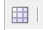
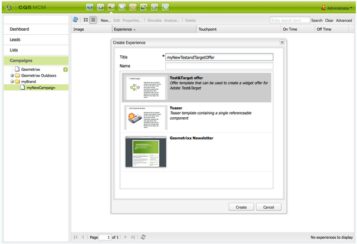

# Target 产品建议{#target-offers}

## 创建Test&amp;Target优惠体验 {#creating-a-test-target-offer-experience}

1. 在左窗格中选择新营销策划，或在右窗格中双击该营销策划。
1. 使用图标选择列表视图：

   

1. 单击&#x200B;**新建……**
1. 您可以指定要创建的&#x200B;**标题**、**名称**&#x200B;和体验类型；在本例中，为Test&amp;Target选件。

   

1. 单击&#x200B;**创建**。

   >[!NOTE]
   >
   >Test&amp;Target体验当前未列在MCM中。 可从“促销活动”下的&#x200B;**网站**&#x200B;控制台访问它们。

## 与 Adobe Target 集成 {#integrating-with-adobe-target}

有关完整的详细信息，请参阅[与Adobe](/help/sites-administering/target.md)集成[Target](/help/sites-administering/target.md)。
