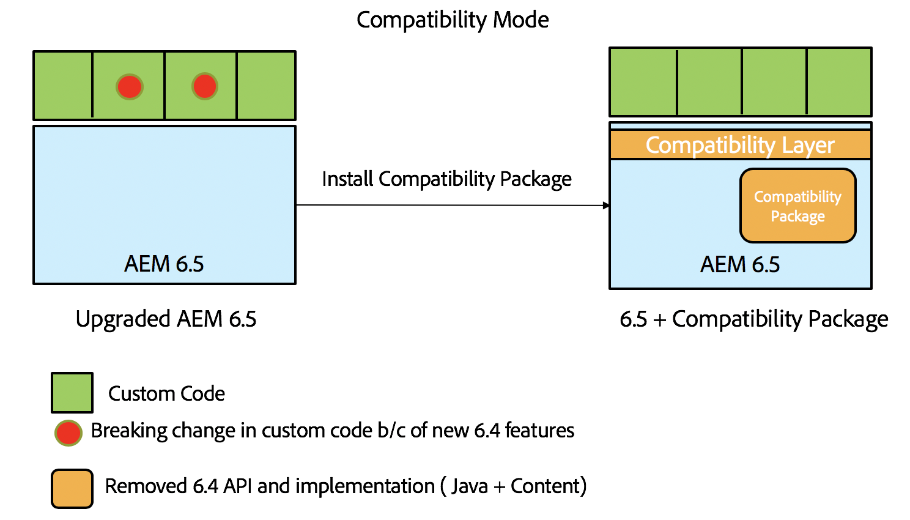
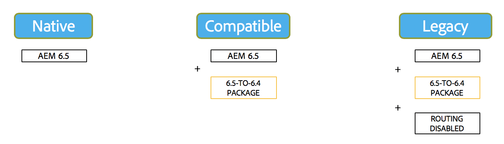
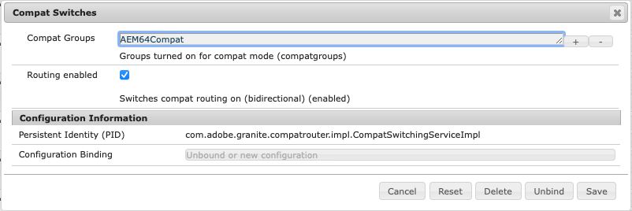

# AEM 6.5 的向后兼容性{#backward-compatibility-in-aem}

## 概述 {#overview}

>[!NOTE]
>
>有关不在此兼容性包范围内的内容和配置更改的列表，请参阅AEM中的[存储库重组](/help/sites-deploying/repository-restructuring.md)。

在Adobe Experience Manager (AEM) 6.5中，开发所有功能时都考虑到了向后兼容性。

通常，运行AEM 6.3的客户在升级时不必更改代码或自定义设置。 对于AEM 6.1和6.2客户，在升级到6.3的过程中不会遇到其他重大更改。

对于无法保持功能向后兼容的异常，可以缓解捆绑包和内容的向后不兼容问题。 为此，请安装6.4的兼容包（有关下载位置的详细信息，请参阅如何设置）。 此兼容包可帮助恢复通常与符合AEM 6.4的应用程序的兼容性。

兼容性包允许您在兼容模式下运行AEM，并推迟针对新AEM功能的自定义开发：

>[!NOTE]
>
>兼容包只是一个临时解决方案，用于推迟兼容AEM 6.5所需的开发。 只有在升级后无法立即通过开发解决兼容性问题时，Adobe才建议将其作为最后一个选项。 此外，Adobe建议您在决定继续基于6.5的自定义开发并充分利用完整的6.5功能后，切换到本机模式并卸载兼容包。

兼容包有两种模式：**启用路由**&#x200B;和&#x200B;**禁用路由**。

这允许AEM 6.5以三种模式运行：

**本机模式：**

本机模式适用于希望使用AEM 6.5的所有新增功能并准备好进行一些开发以使其自定义与所有新功能配合使用的客户。

这意味着升级后必须立即调整应用程序。

**兼容模式：安装的兼容包启用了路由**

“兼容模式”适用于自定义不向后兼容的界面的客户。 这允许AEM在兼容模式下运行，并针对与某些自定义代码不兼容的新AEM功能推迟所需的自定义开发。

**旧模式：兼容包已安装，路由已禁用**

旧版模式适用于具有自定义界面的客户，这些界面基于AEM中已移出兼容包的旧版或已弃用的代码。

## 如何设置 {#how-to-set-up}

可以使用包管理器将6.5 **的** AEM 6.4兼容包作为包进行安装。 您可以从Software Distribution[&#128279;](https://experience.adobe.com/#/downloads/content/software-distribution/en/aem.html?fulltext=compat*&orderby=%40jcr%3Acontent%2Fjcr%3AlastModified&orderby.sort=desc&layout=list&p.offset=0&p.limit=20&package=%2Fcontent%2Fsoftware-distribution%2Fen%2Fdetails.html%2Fcontent%2Fdam%2Faem%2Fpublic%2Fadobe%2Fpackages%2Fcq650%2Fcompatpack%2Faem-compat-cq65-to-cq64)站点下载AEM 6.4 Compatibility Pack for 6.5。

安装兼容包后，可以使用OSGI配置中的交换机启用或禁用路由，如下所示：

安装并设置兼容包后，将根据所选的兼容模式使用功能。
