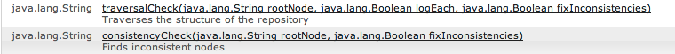

# 一致性与遍历检查{#consistency-and-traversal-checks}

升级时，可能会由于工作区不一致而出现问题。 您可以运行测试升级以查看这是否是问题，也可以将一致性检查作为预防性操作运行。

如果运行因工作区不一致而失败的测试升级，则会在crx-quickstart/logs/crx/error.log中看到与以下内容类似的条目：

```xml
*ERROR* TarPersistenceManager: No bundle found for uuid 'deadbeef-cafe-babe-cafe-babecafebabe'
 ...
*ERROR* RepositoryImpl: Failed to initialize workspace 'crx.default'
javax.jcr.RepositoryException: Error indexing workspace: Error indexing workspace: Error indexing workspace
...
```

## 执行一致性检查 {#perform-a-consistency-check}

要执行一致性检查，请导航到JMX Mbean **com.adobe.granite （存储库）**&#x200B;的管理页面。 从AEM主屏幕，转到：

**工具> Web控制台> Main（位于菜单栏上）> JMX > com.adobe.granite（存储库）**

在默认安装中，可在此处找到它： **[|显示给我|](http://localhost:4502/system/console/jmx/com.adobe.granite%3Atype%3DRepository)**

在该页的&#x200B;**操作**&#x200B;部分中，您找到两种方法： **`traversalCheck`**&#x200B;和&#x200B;**`consistencyCheck`**。 要运行检查，请单击操作并输入所需的参数。


