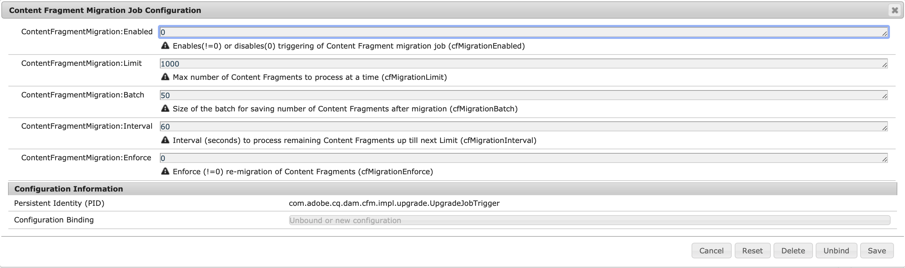

# 更新内容片段以进行优化的 GraphQL 筛选 {#updating-content-fragments-for-optimized-graphql-filtering}

要优化 GraphQL 筛选的性能，可运行一个程序来更新内容片段。

>[!NOTE]
>
>更新内容片段后，可遵循[优化 GraphQL 查询](/help/sites-developing/headless/graphql-api/graphql-optimization.md)的建议。

## 前提条件 {#prerequisites}

确保您至少具有6.5.17.0版本的AEM。

## 更新内容片段 {#updating-content-fragments}

要运行该过程，请执行以下步骤：

1. [为&#x200B;**内容片段迁移作业配置**&#x200B;配置OSGi设置](/help/sites-deploying/configuring-osgi.md)：

   

1. 在对话框中，按以下方式设置这两个参数：

   * **ContentFragmentMigration:Enabled** ： `1`
   * **ContentFragmentMigration:Enforce** ： `1`

1. **保存**&#x200B;规范 — 更新过程开始。

1. 请等待该过程完成。 当属性`cfGlobalVersion`出现在`/content/dam`上并且设置为`1`时，过程已完成。

1. 返回到OSGi配置以取消激活该过程。

   在&#x200B;**内容片段迁移作业配置**&#x200B;的对话框中，按以下方式设置这两个参数：

   * **ContentFragmentMigration:Enabled** ： `0`
   * **ContentFragmentMigration:Enforce** ： `0`

## 限制 {#limitations}

请注意以下限制：

* 只能在完全更新所有内容片段（由 JCR 节点 `/content/dam` 的 `cfGlobalVersion` 属性指示）后，才能优化 GraphQL 筛选器的性能

* 如果在运行更新过程后从包导入了内容片段（使用 `crx/de`），则直到再次执行更新过程后，才会在 GraphQL 查询结果中再次考虑这些内容片段。
