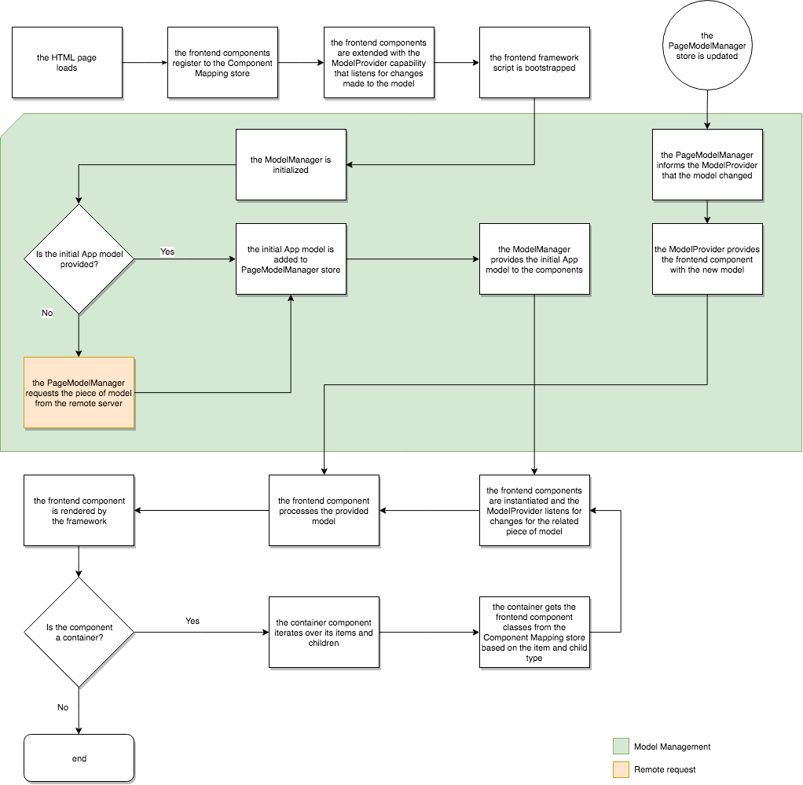

# SPA 的动态模型与组件映射{#dynamic-model-to-component-mapping-for-spas}

本文档介绍了在JavaScript SPA SDK for Adobe Experience Manager (AEM)中如何进行组件映射的动态模型。

{{ue-over-spa}}

## 组件映射模块 {#componentmapping-module}

`ComponentMapping`模块作为NPM包提供给前端项目。 它存储前端组件，并为单页应用程序提供一种将前端组件映射到AEM资源类型的方法。 这可以在解析应用程序的JSON模型时启用组件的动态分辨率。

模型中存在的每个项目都包含一个`:type`字段，该字段公开了AEM资源类型。 安装后，前端组件可以使用从基础库收到的模型片段来呈现自身。

有关模型解析和模型的前端组件访问权限的更多信息，请参阅[SPA Blueprint](/help/sites-developing/spa-blueprint.md)。

另请参阅npm包： [https://www.npmjs.com/package/@adobe/aem-spa-component-mapping](https://www.npmjs.com/package/@adobe/aem-spa-component-mapping)

## 模型驱动的单页应用程序 {#model-driven-single-page-application}

使用适用于AEM的JavaScript SPA SDK的单页应用程序是模型驱动的：

1. 前端组件向[组件映射存储](/help/sites-developing/spa-dynamic-model-to-component-mapping.md#componentmapping-module)注册自身。
1. 然后[容器](/help/sites-developing/spa-blueprint.md#container)一旦由[模型提供程序](/help/sites-developing/spa-blueprint.md#the-model-provider)提供了模型，便会迭代其模型内容(`:items`)。

1. 如果存在页面，则其子页面(`:children`)首先从[组件映射](/help/sites-developing/spa-blueprint.md#componentmapping)获取组件类，然后对其进行实例化。

## 应用程序初始化 {#app-initialization}

使用[`ModelProvider`](/help/sites-developing/spa-blueprint.md#the-model-provider)的功能扩展每个组件。 因此，初始化采用以下常规形式：

1. 每个模型提供程序都会初始化自身，并侦听对与其内部组件相对应的模型段所做的更改。
1. 必须初始化[`PageModelManager`](/help/sites-developing/spa-blueprint.md#pagemodelmanager)，如[初始化流程](/help/sites-developing/spa-blueprint.md)所表示。

1. 存储后，页面模型管理器会返回应用程序的完整模型。
1. 然后，此模型被传递到应用程序的前端根[Container](/help/sites-developing/spa-blueprint.md#container)组件。
1. 模型片段最终传播到每个单独的子元件中。

